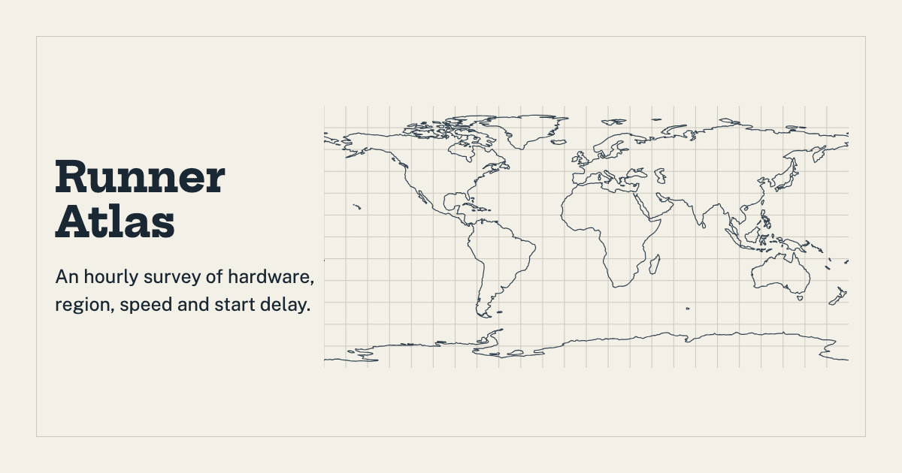
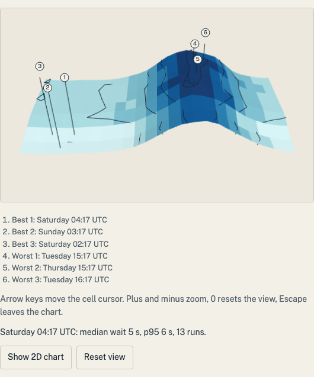
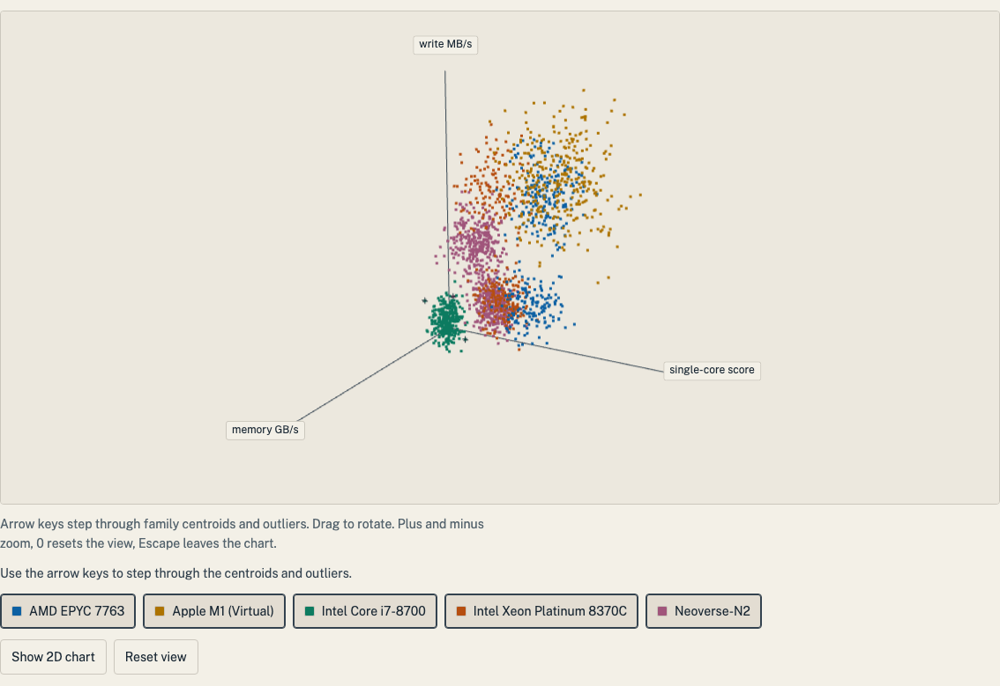
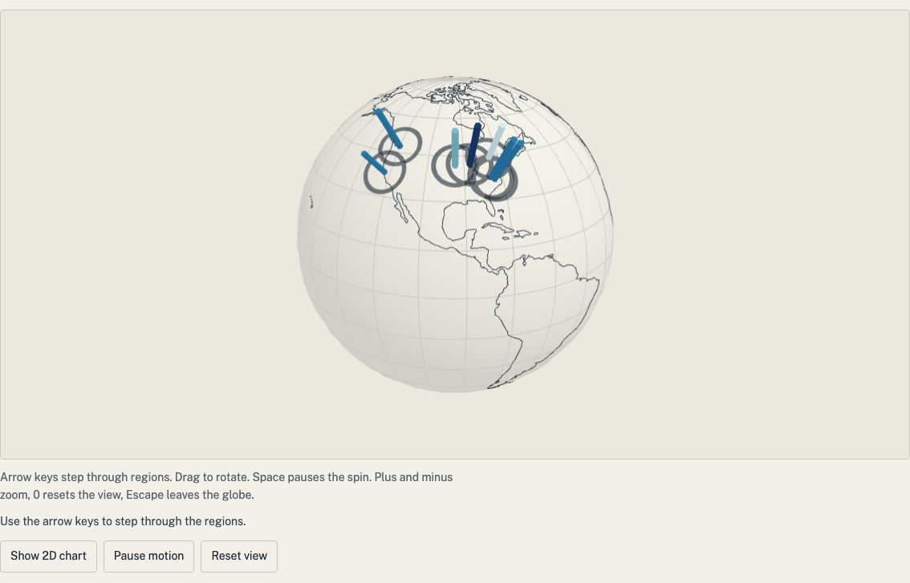
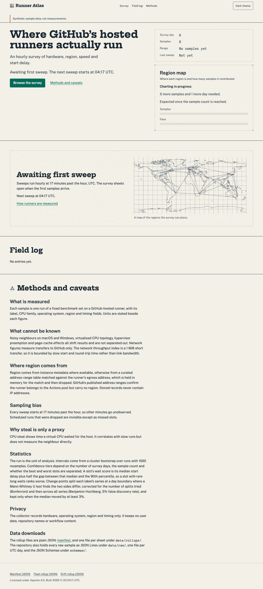

# Runner Atlas

**Live site:** [https://aieatassam.github.io/runner-atlas/](https://aieatassam.github.io/runner-atlas/)

Runner Atlas is an hourly survey of GitHub-hosted Actions runners. Every hour, at 17 minutes past, one
workflow run starts a collector job on each runner label. The collector runs a fixed set of
micro-benchmarks and probes, and records hardware, operating system, region and timing fields. A
publish job validates the samples, commits them, rebuilds the rollups and deploys a static dashboard
with plain JSON downloads.

## What it answers

- Which hour of the week a scheduled job starts fastest, and which slowest, with a 95% interval.
- Which CPU families, memory sizes and regions sit behind each runner label, and in what mix.
- How fast each label computes, writes, reads and reaches GitHub over the network.
- Whether CPU steal on Linux runners goes with slower runs.
- When GitHub rolled out a new runner image, and whether speed or start delay shifted at that point.
- Whether speed and start delay follow a weekly or daily cycle.

Every chart states its unit, its sample and run counts, and the survey date range. Charts open in tiers as
the survey ages. Until a chart opens, its panel says how many more samples and days it needs and, when only
days are short, the date it should open.

## Architecture

```
.github/workflows/atlas.yml   (cron '17 * * * *' and workflow_dispatch; top-level permissions: {})
  plan      reads collector/matrix.json, drops RUNNER_ATLAS_DISABLED_LABELS   contents: read
  collect   one job per label replica, "collect <label> r<replica>"         contents: read, actions: read
            benchmarks under a 20 s budget, sample <= 1600 bytes, uploaded as an artifact
  publish   validates every sample (JSON Schema + privacy scan), quarantines failures,
            appends data/raw/, rebuilds data/rollups/, commits "data: sweep ...",
            builds site/dist                                                 contents: write
  deploy    publishes site/dist to GitHub Pages (environment github-pages)  pages: write, id-token: write

.github/workflows/ci.yml      (push to main, pull requests)
  workflow-lint   actionlint, SHA-pin check on every uses: line
  verify          typecheck, unit tests, build, rollup and bundle checks, collector check, e2e
```

| Path | Purpose |
| --- | --- |
| `collector/` | The runner-side collector (`src/`), `matrix.json`, the region address-range table |
| `aggregator/` | Ingest, validation, dedupe, rollups and statistics (quantiles, MAD, KDE, Mann-Whitney U, Benjamini-Hochberg, cluster bootstrap) and the field log |
| `shared/types/` | TypeScript types for raw samples and rollups |
| `schemas/` | JSON Schema 2020-12 for raw samples and every rollup file |
| `site/` | The Vite dashboard: shell, progressive panels, D3 charts, three lazy-loaded Three.js scenes |
| `data/rollups/` | The published rollups (Day-0 until the first live sweep) |
| `data/raw/` | Raw samples as JSON Lines, one file per UTC day (only `.gitkeep` before the first sweep) |
| `scripts/` | Publish loop, fixtures, synthetic data, screenshots and verification scripts |
| `tests/` | Vitest unit and integration tests, Playwright end-to-end tests |
| `audit/` | The screenshot gallery and the Hallmark design audit |
| `SPEC.md`, `DESIGN.md`, `DECISIONS.md` | The specification, the locked visual system and the decision log |

## Runner matrix

Defined in `collector/matrix.json`. Each sweep runs eleven collector jobs, three of them on macOS.

| Label | Replicas | Optional | OS and CPU |
| --- | --- | --- | --- |
| `ubuntu-24.04` | 3 | no | Linux x64 |
| `ubuntu-24.04-arm` | 2 | no | Linux arm64 |
| `windows-2025` | 2 | no | Windows x64 |
| `windows-11-arm` | 1 | yes | Windows arm64 |
| `macos-15` | 2 | no | macOS arm64 |
| `macos-15-intel` | 1 | yes | macOS x64 |

Public repositories get 20 concurrent jobs, 5 of them on macOS. A sweep peaks at 11 jobs and 3 macOS jobs,
because `plan`, `publish` and `deploy` never run alongside the collectors. Optional labels run with
`continue-on-error`. A label can be switched off without a code change through
`RUNNER_ATLAS_DISABLED_LABELS` (see [SETUP.md](SETUP.md)).

## Visual tour

Every image below comes from `npm run audit:screenshots` using **synthetic data**, never measurements. Each
page carries the notice "Synthetic sample data, not measurements." The gallery in `audit/screenshots/`
holds 47 PNGs:

- days 0, 1, 3, 7, 14, 30 and 90;
- widths 375, 1280 and 1440, in light and dark;
- a no-WebGL capture, the three 3D scenes and the Methods section.

### Day 1: the first charts

| Light, 1440 px | Dark, 1440 px |
| --- | --- |
|  |  |

### Day 7: drift and the first ranked slots

| Light, 1440 px | Dark, 1440 px |
| --- | --- |
|  |  |

### Day 30: rollouts and change points

| Light, 1440 px | Dark, 1440 px |
| --- | --- |
|  |  |

### Day 90: every tier open

| Light, 1440 px | Dark, 1440 px |
| --- | --- |
|  |  |

### On a phone (375 px, Day 90)

| Light | Dark |
| --- | --- |
|  |  |

### The three 3D scenes (Day 90)

| Delay terrain | Benchmark point cloud | Telemetry globe |
| --- | --- | --- |
|  |  |  |

Each scene loads only when its panel scrolls into view. Each has a "Show 2D chart" toggle, keyboard
controls and spoken cursor readouts. Without WebGL every scene draws its 2D chart and says why
(`audit/screenshots/day-90-1280-light-nowebgl.png`).

### Day 0: before the first sweep



## Progressive tiers

| Tier | Opens when | Panels |
| --- | --- | --- |
| Day 0 | no samples | Standby: when the next sweep starts, the survey map, Methods |
| Day 1 | 1 day, 5 samples | Fleet mix, fleet by label, recent samples, globe preview, region map |
| Day 3 | 3 days, 120 samples | Speed by label (ridgelines), runs by label (beeswarm), point cloud |
| Day 7 | 7 days, 500 samples | Start delay by slot, delay terrain, best and worst slots |
| Day 14 | 14 days, 1,200 samples | Steal against score, steal by label and family |
| Day 30 | 30 days, 3,000 samples | Runner image share over time, change points |
| Day 90 | 90 days, 9,000 samples | Speed bands across the cycle, weekday and hour effects |

Tiers are defined in `SPEC.md` section 5. With full coverage a survey gathers about 264 samples a day, so
each tier opens on its day.

## Methodology and caveats

The full statistics and rollup contracts are in `SPEC.md` section 4. In short:

- **The run is the unit of analysis.** Intervals come from a cluster bootstrap over runs with 1000
  resamples.
- **Best and worst slot.** A slot is an hour of the week (or an hour of the day early in the survey). Its
  wait score is `median + 0.5 × (p90 − median)` of the run start delays in that slot, so rare long waits
  rank a slot worse. A slot needs at least 3 runs to be ranked. Confidence moves from preliminary to high
  with survey days and coverage, and drops one step when the best and worst intervals overlap.
- **Change points.** Each label's series is split at a day boundary where a Mann-Whitney U test finds
  the two sides differ. Splits are found by binary segmentation, Bonferroni-corrected within a series and
  Benjamini-Hochberg-corrected across series at a 5% false discovery rate. A split is kept only when the
  median moved by at least 3%.
- **Benchmark axes** span the 1st to 99th percentile of each metric, so they are zoomed to the data and
  do not start at zero.
- **CPU steal is a proxy** for noisy neighbours. It correlates with slow runs but does not measure the
  neighbour. On macOS and Windows, noisy neighbours, virtualised CPU topology, hypervisor preemption and
  page-cache effects are not separated out.
- **Region** comes from instance metadata where available, otherwise from a curated address-range table
  matched against the egress address. GitHub's published address ranges confirm the runner belongs to
  the Actions pool but carry no region.
- **Sampling bias.** Every sweep starts at 17 minutes past the hour, so other minutes go unobserved.
  Scheduled runs that GitHub drops show only as missed slots.
- **Network figures** measure transfers to GitHub only. The throughput index is a 1 MiB transfer, so slow
  start and round-trip time bound it, not link bandwidth.

## Guardrails

- **Time box.** The benchmarks run under a hard 20 s budget (`TOTAL_BUDGET_MS = 20_000`), and each job has a
  6-minute timeout. Every subprocess has a 3 s timeout and fixed arguments, with no shell.
- **What is never stored.** No IP addresses, hostnames (`os.hostname()` is never called), usernames, home
  paths, MAC addresses, tokens or secrets. Environment variables outside a five-name allowlist (`ImageOS`,
  `ImageVersion`, `RUNNER_OS`, `RUNNER_ARCH`, `RUNNER_ENVIRONMENT`) are never read into a sample. The egress
  address lives only in one local variable for the region match.
- **Validation.** `publish` checks every sample against the JSON Schema and a privacy scan that rejects
  any IP-like string. It also enforces a 2048-byte limit. Failures are quarantined, listed in the job
  summary and never committed.
- **Passive only.** The collector calls GitHub's API, a raw file on `raw.githubusercontent.com`, the
  instance metadata service and one Cloudflare trace endpoint (for the egress address). It does no port
  scanning and does not probe other hosts.
- **Pinned actions.** Every `uses:` line is pinned to a 40-character commit SHA with the tag in a comment.
  The workflows use only `actions/*`, and CI fails on any unpinned line.
- **Least privilege.** Both workflows start from `permissions: {}`, and each job declares only what it
  needs. Only `publish` can write to the repository.

## Synthetic data

The screenshots and the Day-1 to Day-90 test fixtures use data from `scripts/synthetic/generate.ts`.
Synthetic samples carry `src: "synthetic"`, and their rollups carry `dataSource: "synthetic"`, which
shows the notice on every page. The generator refuses to write inside `data/`, so synthetic data never
reaches the published dataset.

## Development

Requires Node 22.18 or later, which runs the TypeScript sources directly.

```sh
npm ci
npm run typecheck          # tsc --noEmit
npm test                   # Vitest unit and integration tests
npm run build              # site/dist from data/rollups (Day-0 until the first sweep)
npm run preview            # serves site/dist on http://127.0.0.1:4173/
npm run e2e                # Playwright, day-0 and day-90 projects (builds its own fixtures)
npm run verify:rollups     # schema-validates data/rollups and its manifest checksums
npm run verify:bundle      # entry JS gzip budget (90 kB)
npm run verify:collector   # runs the collector locally and checks the sample
npm run audit:screenshots  # the 47-image gallery in audit/screenshots/ (synthetic only)
npm run verify             # typecheck, test, build, the three verify scripts and e2e, in that order
```

To generate a synthetic survey and view it:

```sh
npm run synthetic -- --days 90 --seed 7 --start 2026-01-05 --out .tmp/synthetic/day-90
RUNNER_ATLAS_ROLLUPS_DIR=.tmp/synthetic/day-90/rollups npm run build
npm run preview
```

`RUNNER_ATLAS_ROLLUPS_DIR` is resolved from the repository root. Run `npm run build` again without it
before committing, so `site/dist` goes back to the Day-0 data. At build time,
`RUNNER_ATLAS_SITE_URL` sets the share tags (`og:url`, `og:image`). `RUNNER_ATLAS_REPO_URL` sets the
repository link, and in Actions it defaults to the current repository.

Repository and deployment setup are in [SETUP.md](SETUP.md).

## Licence

The code is Apache-2.0 (`LICENSE`). `NOTICE` credits the data sources, fonts and artwork.
`THIRD_PARTY_LICENSES.md` lists the bundled and development dependencies.
